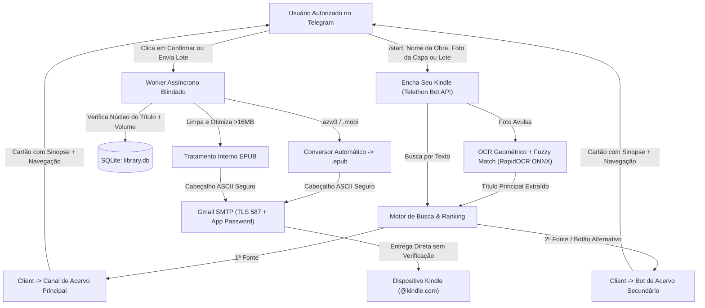

# 📚 Encha Seu Kindle

Ferramenta de automação multiusuário no Telegram para organização de biblioteca digital, reconhecimento óptico de capas (OCR), conversão de formatos legados (`.azw3` / `.mobi` $\rightarrow$ `.epub`), tratamento de metadados internos e entrega direta de documentos e e-books ao **Amazon Kindle** via SMTP autenticado (SPF/DKIM), eliminando e-mails de confirmação manual da Amazon e erros de entrega (`E001` e `E009`).

---

## ✨ Principais Funcionalidades

- **🚀 Envio Direto Autenticado (Zero Verificação Manual):** Disparo via Gmail SMTP com Senha de App oficial (SPF e DKIM alinhados), entregando documentos e livros diretamente na biblioteca do Kindle sem exigir confirmação por link a cada envio.
- **🔍 Busca Inteligente Multi-Fonte com Sinopse Real:**
  - Digite o nome da obra no chat do bot **Encha Seu Kindle**.
  - O algoritmo pontua os resultados priorizando correspondência exata e similaridade ortográfica (*Fuzzy Matching*) no núcleo do título (evitando que continuações que citam o Volume 1 na sinopse apareçam antes do original) e dá preferência ao formato `.epub`.
  - Exibe a **sinopse real** extraída da postagem do acervo, além de botões interativos para **navegar entre resultados** (`⬅️ Anterior` / `➡️ Próximo`), **alternar para a fonte de acervo secundária** (`🌐 Buscar na Fonte Secundária`) ou **confirmar o envio** (`✅ Confirmar e Enviar para o Kindle`).
- **📸 Reconhecimento de Capas por OCR Geométrico (`RapidOCR`):**
  - Envie apenas a **foto avulsa da capa de um livro**.
  - O motor analisa a geometria das caixas de texto detectadas (altura real da fonte em pixels, largura e orientação horizontal/vertical) para isolar o **Título Principal** e o **Autor**, ignorando frases promocionais pequenas no topo, citações, selos de editoras e plaquinhas inclinadas.
  - Inclui tolerância *fuzzy* (`difflib.SequenceMatcher`) e busca por caixas isoladas para reconhecer com precisão títulos em fontes góticas ou caligráficas estilizadas.
- **📦 Envio de Capas Encaminhadas e Lotes com Painel em Tempo Real:**
  - Encaminhe 1 item ou um lote de 50+ itens de uma só vez de um canal de acervo no Telegram.
  - O bot agrupa o lote automaticamente e exibe **um único painel interativo com barra de progresso em tempo real** (`🟩🟩🟩🟩🟩⬜⬜⬜⬜⬜`), evitando *FloodWait* no Telegram.
- **🔄 Conversão Automática Anti-Erro `E001` (`.azw3` / `.mobi` $\rightarrow$ `.epub`):**
  - Como a Amazon descontinuou o suporte a `.mobi` e `.azw3` por e-mail, qualquer arquivo nesses formatos é convertido automaticamente em segundo plano para `.epub` nativo antes do envio.
- **🧹 Limpeza de Títulos, Metadados Internos e Otimização (Anti-Erro `E009`):**
  - Remove sublinhados (`_`), prefixos `(TM)` e sufixos de domínios tanto do nome do arquivo quanto da tag interna `<dc:title>` dentro do pacote `.epub` (`content.opf`).
  - Sanitiza o cabeçalho MIME do anexo em ASCII puro para evitar o erro `E009` (*Sem anexo*) do servidor de e-mail da Amazon em títulos com acentuação.
  - Comprime automaticamente imagens internas de arquivos `.epub` maiores que 16 MB usando `Pillow` para respeitar o limite de 25 MB do Gmail/Kindle.
- **🛡️ Trava Inteligente de Duplicidade por Usuário (SQLite):**
  - Banco de dados `library.db` individual por usuário que impede o envio acidental de documentos repetidos, diferenciando com precisão volumes distintos de uma mesma série (ex: *Volume 1* vs *Volume 2* ou obras diferentes do mesmo autor) e oferecendo botão para forçar o reenvio quando desejado.
- **👥 Interface Multiusuário Privada (*Onboarding* Guiado):**
  - Lista restrita de IDs do Telegram autorizados (`ALLOWED_USER_IDS`), onde cada leitor cadastra seu próprio e-mail `@kindle.com` em 2 passos pelo comando `/start`.

---

## 🏗️ Arquitetura de Funcionamento



---

## ⚙️ Pré-requisitos

1. **Python 3.10+** instalado no servidor Linux/Windows.
2. **Credenciais da API do Telegram (`API_ID` e `API_HASH`):**
   - Acesse [my.telegram.org](https://my.telegram.org), faça login e crie um app em *API development tools*.
3. **Token de Bot do Telegram (`TELEGRAM_BOT_TOKEN`):**
   - Crie seu bot **Encha Seu Kindle** conversando com o [@BotFather](https://t.me/BotFather) no Telegram.
4. **Conta Gmail com Senha de App de 16 dígitos (`GMAIL_APP_PASSWORD`):**
   - Na sua conta Google, ative a Verificação em Duas Etapas e gere uma **Senha de App** em [myaccount.google.com/apppasswords](https://myaccount.google.com/apppasswords).
5. **Autorização do E-mail na Amazon:**
   - Cada usuário do bot deve acessar [amazon.com.br/mycd](https://www.amazon.com.br/mycd) $\rightarrow$ **Preferências** $\rightarrow$ **Configurações de documentos pessoais** $\rightarrow$ **Lista de endereços de e-mail aprovados** e adicionar o endereço configurado em `GMAIL_USER`.

---

## 🚀 Instalação e Configuração

### 1. Clonar o repositório e criar o ambiente virtual

```bash
git clone https://github.com/RenanCaceres/Encha-Seu-Kindle.git
cd Encha-Seu-Kindle

python3 -m venv venv
source venv/bin/activate
pip install --upgrade pip
pip install -r requirements.txt
```

### 2. Configurar as variáveis de ambiente (`.env`)

Copie o arquivo de exemplo `.env.example` para `.env` e preencha com os seus dados reais:

```bash
cp .env.example .env
nano .env
```

| Variável | Descrição |
| :--- | :--- |
| `TELEGRAM_API_ID` | ID numérico da API do Telegram obtido em `my.telegram.org` |
| `TELEGRAM_API_HASH` | Hash secreto da API do Telegram |
| `TELEGRAM_BOT_TOKEN` | Token do seu bot gerado no `@BotFather` |
| `ADMIN_USER_ID` | ID numérico do Telegram do administrador principal |
| `ADMIN_NAME` | Nome de exibição do administrador |
| `ALLOWED_USER_IDS` | IDs numéricos do Telegram autorizados a usar o bot (separados por vírgula) |
| `GMAIL_USER` | E-mail Gmail que fará o disparo autenticado para a Amazon |
| `GMAIL_APP_PASSWORD` | Senha de App de 16 caracteres do Gmail |
| `KINDLE_EMAIL` | E-mail `@kindle.com` padrão do administrador |
| `SOURCE_CHANNEL` | Username do canal de acervo principal no Telegram |
| `SECONDARY_SOURCE_BOT` | Username do bot de acervo secundário no Telegram |
| `SEND_DELAY_SECONDS` | Intervalo em segundos entre envios de e-mail na fila (padrão: `5`) |

### 3. Primeiro login da sessão do Telegram

Na primeira execução, rode o script manualmente no terminal para autenticar a sessão do cliente principal:

```bash
./venv/bin/python bot.py
```

Após autenticar com o código enviado ao seu Telegram, os arquivos `.session` serão gerados localmente (protegidos pelo `.gitignore`).

---

## 🔄 Execução 24/7 como Serviço (`systemd`)

Para manter o **Encha Seu Kindle** rodando continuamente em segundo plano no Linux (mesmo após logout ou reinicialização):

```bash
mkdir -p ~/.config/systemd/user
cat << 'EOF' > ~/.config/systemd/user/encha-seu-kindle.service
[Unit]
Description=Encha Seu Kindle - Bot do Telegram
After=network-online.target

[Service]
Type=simple
WorkingDirectory=/caminho/para/Encha-Seu-Kindle
ExecStart=/caminho/para/Encha-Seu-Kindle/venv/bin/python /caminho/para/Encha-Seu-Kindle/bot.py
Restart=always
RestartSec=10

[Install]
WantedBy=default.target
EOF

loginctl enable-linger $USER
systemctl --user daemon-reload
systemctl --user enable --now encha-seu-kindle.service
systemctl --user status encha-seu-kindle.service
```

---

## 📱 Comandos Disponíveis e Manual em PDF

Consulte também o guia rápido ilustrado do usuário incluído no repositório: [`Manual_Encha_Seu_Kindle.pdf`](./Manual_Encha_Seu_Kindle.pdf).

| Comando | Função |
| :--- | :--- |
| `/start` ou `/menu` | Abre o painel interativo do **Encha Seu Kindle** com status do aparelho e botões |
| `/config` | Inicia o assistente em 2 passos para cadastrar ou alterar o e-mail `@kindle.com` |
| `/biblioteca` | Exibe o total de livros já enviados ao Kindle do usuário e os 5 envios mais recentes |

---

## 🔒 Segurança, Privacidade e Aviso Legal (*Disclaimer*)

- **Zero Credenciais no Código:** Nenhuma chave de API, token de bot, senha de aplicativo, e-mail pessoal ou ID de usuário do Telegram fica exposto no código-fonte. Toda a configuração é lida exclusivamente do arquivo `.env`.
- **Proteção no Git (`.gitignore`):** Arquivos `.env`, bancos de dados `*.db`, e-books (`*.epub`, `*.mobi`, `*.azw3`) e sessões `*.session` estão bloqueados no `.gitignore`.
- **⚖️ Aviso Legal e Direitos Autorais:** Este projeto é um software utilitário de código aberto (*open-source*) voltado exclusivamente para **estudo de engenharia de software, automação de envio de documentos pessoais, artigos acadêmicos, apostilas próprias e obras literárias em domínio público** (como acervos do *Project Gutenberg* e *Portal Domínio Público*). Este repositório **não hospeda, não indexa e não distribui** nenhum arquivo protegido por direitos autorais. O usuário final é integralmente responsável por garantir que possui os direitos ou licenças aplicáveis sobre quaisquer documentos que envie ao seu dispositivo pessoal.
